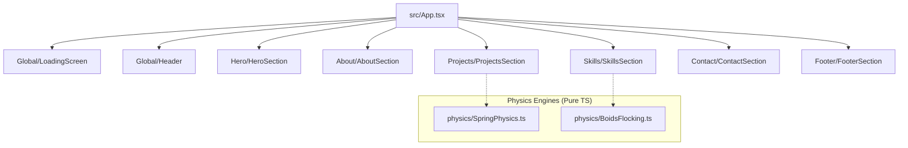
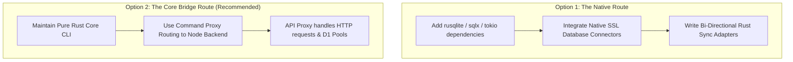

# ENGINEERING BLUEPRINT: THE MASTER ROADMAP
## Dual-System Implementation Strategy for Toto's Engineering Ecosystem

This document serves as the master implementation blueprint for continuing the development of both the **Interactive React Portfolio (`new-personal-profolio`)** and the **HKUST Climbing App Backend (`cli-backend`)**. 

It outlines the current state of both repositories, defines the architecture for missing components, and establishes a sequential development plan that honors the **3-file component pattern** for React and the **zero-dependency, high-integrity constraints** of the Rust CLI.

---

## 🏛️ PART 1: THE PORTFOLIO ROADMAP (`new-personal-profolio`)

### 1. Current Architecture vs. Target Specifications
The portfolio currently has its foundational skeletons, styling tokens (`tailwind.config.js`), and core physics systems (`SpringPhysics.ts` & `BoidsFlocking.ts`) established. The components under `src/components/Global` and `src/components/Hero` exist as empty container structures. The remaining sections (`About`, `Projects`, `Skills`, `Contact`, `Footer`) are simple stub components.



### 2. Immediate Next Steps: Component Polish & Execution

We must build out the portfolio sequentially in accordance with `docs/phase-roadmap.md`:
1. **HTML Structure** $\rightarrow$ 2. **Hover Interactions** $\rightarrow$ 3. **Appear/Entrance Animations** $\rightarrow$ 4. **Scroll-Linked Section Transitions**.

Below is the step-by-step implementation guide for each section.

---

### Phase A: Complete the Hero Section (`src/components/Hero`)
The centerpiece of the Hero section is the **Avatar Container** with its "Gacha Mask" flashlight effect, liquid click reveal, and title comet stream.

#### 1. Implement `AvatarContainer.effects.ts` (Flashlight Mask & Idle Timer)
To prevent the chaotic strobing of image styles during active mouse sweeps, implement an intentional **setTimeout debounce** that randomizes the mask image only when mouse movement pauses for $600\text{ms}$.

```typescript
// src/components/Hero/AvatarContainer/AvatarContainer.effects.ts
import { RefObject } from 'react'

interface AvatarEffectsProps {
  containerRef: RefObject<HTMLDivElement>
  onBaseImageChange: (index: number) => void
  onMaskImageChange: (index: number) => void
}

export const setupAvatarEffects = ({
  containerRef,
  onBaseImageChange,
  onMaskImageChange,
}: AvatarEffectsProps) => {
  const container = containerRef.current
  if (!container) return () => {}

  let idleTimer: NodeJS.Timeout
  const imageCount = 4 // Photo, ASCII, Pixel-Picasso, Depth-Dots

  const handleMouseMove = (e: MouseEvent) => {
    const rect = container.getBoundingClientRect()
    const x = e.clientX - rect.left
    const y = e.clientY - rect.top

    // Update CSS custom variables for clip-path positioning
    container.style.setProperty('--mouse-x', `${x}px`)
    container.style.setProperty('--mouse-y', `${y}px`)

    // Debounce: Clear idle timer during active scrubbing
    clearTimeout(idleTimer)
    idleTimer = setTimeout(() => {
      // Idle re-roll: random style transition for mask layer after 600ms pause
      const nextMaskIndex = Math.floor(Math.random() * imageCount)
      onMaskImageChange(nextMaskIndex)
    }, 600)
  }

  container.addEventListener('mousemove', handleMouseMove)

  return () => {
    container.removeEventListener('mousemove', handleMouseMove)
    clearTimeout(idleTimer)
  }
}
```

#### 2. Implement the "Liquid Click Reveal" in `AvatarContainer.tsx`
Create the water ripple displacement mask on click using an expanding `clip-path` combined with an SVG noise filter:

```xml
<!-- Add to index.html -->
<svg class="hidden">
  <defs>
    <filter id="liquid-ripple">
      <feTurbulence type="fractalNoise" baseFrequency="0.02" numOctaves="3" result="noise" />
      <feDisplacementMap in="SourceGraphic" in2="noise" scale="30" xChannelSelector="R" yChannelSelector="G" />
    </filter>
  </defs>
</svg>
```

Apply this in `AvatarContainer.tsx` on pointer interaction:
- Detect the click coordinates `(e.clientX, e.clientY)` inside the element.
- Inject a circular clip-path mask that rapidly scales to `150%` radius.
- Temporarily halt hover tracking using a state lock (`isLiquidAnimating`).
- Commit the mask style as the new base image: `onBaseImageChange(maskIndex)`.

#### 3. Main Title Comet Stream Animation (`MainTitle.animation.ts`)
The letters of the title `"Hi, I am Toto"` must shoot from the right side of the avatar in reverse-character order with slight Y coordinate randomness:

```typescript
// src/components/Hero/MainTitle/MainTitle.animation.ts
export const titleCharAnimation = (index: number, totalChars: number) => {
  const reverseIndex = totalChars - 1 - index
  return {
    initial: {
      x: 800,
      y: Math.random() * 200 - 100, // randomized Y threshold
      opacity: 0,
    },
    animate: {
      x: 0,
      y: 0,
      opacity: 1,
      transition: {
        type: 'spring',
        stiffness: 70,
        damping: 15,
        delay: reverseIndex * 0.05, // reverse order delivery
      },
    },
  }
}
```

---

### Phase B: Build the About Section (`src/components/About`)
The About section focuses on the **Heat Haze Text Stabilization** and the **Plasma Shooter Box Melting** effects.

#### 1. Implement `BioText.effects.ts` (Heat Haze Text Stabilization)
Rather than updating React state coordinates (which causes severe DOM thrashing), capture scroll/mouse coordinates and toggle classnames directly on target spans using a `requestAnimationFrame` loop:

```typescript
// src/components/About/BioText/BioText.effects.ts
import { RefObject } from 'react'

export const setupBioTextEffects = (containerRef: RefObject<HTMLDivElement>) => {
  const container = containerRef.current
  if (!container) return () => {}

  const words = container.querySelectorAll('.hazeword')
  
  const updateFocuser = (x: number, y: number) => {
    words.forEach((word) => {
      const rect = word.getBoundingClientRect()
      const centerX = rect.left + rect.width / 2
      const centerY = rect.top + rect.height / 2
      const dist = Math.sqrt((x - centerX) ** 2 + (y - centerY) ** 2)

      if (dist < 150) {
        word.classList.add('cooled')
      } else {
        word.classList.remove('cooled')
      }
    })
  }

  const handleMouseMove = (e: MouseEvent) => {
    requestAnimationFrame(() => updateFocuser(e.clientX, e.clientY))
  }

  window.addEventListener('mousemove', handleMouseMove)
  return () => window.removeEventListener('mousemove', handleMouseMove)
}
```

Add supporting styles in `index.css`:
```css
.hazeword {
  color: transparent;
  text-shadow: 0 0 12px rgba(248, 250, 252, 0.65);
  transition: all 0.4s ease-out;
}
.hazeword.cooled {
  color: #F8FAFC;
  text-shadow: 0 0 0px rgba(248, 250, 252, 1);
  transition: all 0.15s ease-out;
}
```

#### 2. Implement the Plasma Shooter Click Melt (`TechStackBox.effects.ts`)
Clicking any left tech stack box triggers a `1.5s` plasma melting animation, dynamically shifting `border-radius` variables under an SVG displacement filter:

```typescript
// src/components/About/TechStackBox/TechStackBox.effects.ts
export const setupBoxMelt = (boxElement: HTMLDivElement) => {
  boxElement.classList.add('melting')
  
  // Randomize border radii dynamically for fluid organic melt
  const interval = setInterval(() => {
    const r1 = Math.floor(Math.random() * 30 + 10)
    const r2 = Math.floor(Math.random() * 30 + 10)
    boxElement.style.borderRadius = `${r1}% ${100-r1}% ${r2}% ${100-r2}%`
  }, 100)

  setTimeout(() => {
    clearInterval(interval)
    boxElement.classList.remove('melting')
    boxElement.style.borderRadius = '16px' // reset to rigid geometry
  }, 1500)
}
```

---

### Phase C: Build the Projects Section (`src/components/Projects`)
A lightweight 3D gallery environment inside a VR Headset viewport. Leverages `SpringPhysics.ts` to suspend cards under a simulated wind and gravity model.

#### 1. Wire the Aerodynamic Wind & Springs (`SpringPhysicsManager.effects.ts`)
Map custom mouse movement variables to wind acceleration in the physics tick loop:

```typescript
// src/components/Projects/SpringPhysicsManager/SpringPhysicsManager.effects.ts
import { SpringPhysicsEngine, SpringBody } from '../../../physics/SpringPhysics'

export const initializeProjectsPhysics = (
  cards: SpringBody[], 
  onUpdate: (bodies: Map<string, SpringBody>) => void
) => {
  const engine = new SpringPhysicsEngine()
  cards.forEach((card) => engine.addBody(card))

  let lastMouseX = 0
  let lastMouseY = 0
  let lastTime = Date.now()

  const handleMouseMove = (e: MouseEvent) => {
    const now = Date.now()
    const dt = now - lastTime
    if (dt > 0) {
      const vx = (e.clientX - lastMouseX) / dt
      // Set wind force proportional to mouse velocity X
      engine.windForce = vx * 0.05 
    }
    lastMouseX = e.clientX
    lastMouseY = e.clientY
    lastTime = now
  }

  // Physics update interval at 60fps
  const interval = setInterval(() => {
    engine.update(0.016)
    onUpdate(new Map(engine.bodies))
    // Slowly decay wind force back to 0
    engine.windForce *= 0.95
  }, 16)

  window.addEventListener('mousemove', handleMouseMove)

  return {
    spawnGravityWell: (x: number, y: number) => {
      engine.clearGravityWells()
      engine.addGravityWell(x, y, 500)
    },
    clearWells: () => engine.clearGravityWells(),
    destroy: () => {
      clearInterval(interval)
      window.removeEventListener('mousemove', handleMouseMove)
    }
  }
}
```

#### 2. Implement the Curtain Drag & Orbital Modal Reveal
- Pause aerodynamic calculations for a card when hovered.
- Add standard touch/mouse drag state variables (`isDragging`, `dragStartX`).
- Dragging horizontally transforms the card scale and clip-path to look like a tearing curtain.
- Drag threshold $> 30\%$: triggers full modal expansion, where technology pills fade out and begin an orbital animation loop around the central prism.

---

### Phase D: Build the Skills Section (`src/components/Skills`)
Transforms vertical mouse scrolling to a **horizontal cinematic pan** ($300\text{vw}$) across a deep indigo bioluminescent trench featuring a live flocking boids simulation.

#### 1. Bind Horizontal Camera Pan (`SkillsSection.effects.ts`)
```typescript
// src/components/Skills/SkillsSection/SkillsSection.effects.ts
export const setupHorizontalScroll = (containerRef: React.RefObject<HTMLDivElement>) => {
  const container = containerRef.current
  if (!container) return () => {}

  const handleWheel = (e: WheelEvent) => {
    if (e.deltaY !== 0) {
      e.preventDefault()
      // Translate vertical wheel scroll to horizontal container pan
      container.scrollLeft += e.deltaY
    }
  }

  container.addEventListener('wheel', handleWheel, { passive: false })
  return () => container.removeEventListener('wheel', handleWheel)
}
```

#### 2. Implement Boids Flocking & Food Feeding Frenzy
Using `BoidsFlocking.ts`, bind boids to their specific Category Reefs (UI, AI, Software, Hardware) using gravity vectors.
- **Cursor attraction**: The cursor acts as bioluminescent bait, attracting boids if within a $150\text{px}$ radius.
- **Golden Food Particle Click**: Clicking drops a golden ember. The system instantly triples the target speed parameters of local boids, steering them directly towards the coordinate. The boid that collides first consumes the particle (triggering a visual canvas spark) and resets the flock.
- **Shockwave Reset**: Clicking the fixed `[ DEEP ECOSYSTEM ]` header draws a canvas ripple that forces all boids to clear current velocity arrays and return instantly to reef orbits.

---

### Phase E: Build the Contact & Footer Sections
A pitch-black cave environment lit strictly by a circular custom cursor mask, ending in a hard system reboot.

#### 1. Flashlight Mask & Torch Bracket (`FlashlightCursor.effects.ts`)
The `FlashlightCursor` acts as a circular clip mask revealing text underneath.
- Hide the "Torch Bracket" on a hidden section of the wall.
- Proximity detection: sweep over the bracket to show a faint `[ Ignite Torch ]` prompt.
- Clicking the bracket disables the flashlight system, fades the darkness mask to `opacity: 0`, and scales ambient light values to `rgba(249, 115, 22, 0.1)` with CSS flickers simulating warm firelight.

#### 2. System Override Deja Vu Hard Snap (`FooterSection.effects.ts`)
When crossing the `1px` threshold containing `> system.override(tototofu);`:
- Instantly unmount or hide all canvases, WebGL contexts, and custom scroll systems.
- Zero easing transitions. Cut instantly to rigid CSS grids in `FooterSection`.
- Kill all active animation frames and timers.

---

## 🦀 PART 2: THE BACKEND CLI ROADMAP (`cli-backend`)

### 1. Current Technical Achievements
The Rust binary (`bcli`) is extremely robust. Since it relies on **zero standard dependencies** in `Cargo.toml`, it implements custom modules with maximum efficiency:
- **Sandbox Shield**: Accidental sync guard that scans environment variables and aborts if production endpoints are found (e.g. `SUPABASE_PRODUCTION_URL` or active Expo links containing `climbing-hkust`).
- **Fuzzy Native Correction**: Real-time native command correction utilizing a custom Levenshtein distance implementation.
- **Integrity Validation**: Computes `SHA-256` checksums using system native binaries (`certutil` on Windows, `sha256sum` on Unix/Linux) to scan database backups and verify matches.
- **Path Containment Security**: Safely prevents traversal exploits (`../../`) by validating all target paths against canonical absolute parent directories.

---

### 2. Strategic Implementation Goals: Live Connectivity & Database Integrations
The next major evolution of `bcli` is transitioning from mock dry-run scripts to **fully active live sync pools** between the SQLite local data layer and the remote Supabase API.

To achieve this without bloating the binary or breaking the zero-dependency goal, we must choose between two paths:



#### Why Option 2 is Preferred
The codebase already features a built-in proxy executor (`run_proxy` in `main.rs`, lines 50-73) which automatically forwards legacy and complex cloud commands to a Node-based API CLI wrapper `cli/api.js`. 

We should leverage this bridge to keep the Rust binary extremely fast, secure, and compact:
1. **Maintain Rust as the secure orchestrator & validator**: Handle CLI parser routing, sandbox shield verifications, system health scans (`doctor`), directory sandboxing, and backup checksum writes inside Rust.
2. **Delegate Network I/O Pools to the proxy**: Forward the actual heavy API requests, Webhooks, and remote Supabase syncing to the Javascript client proxy which contains native SDK integrations.

#### Execution Plan for cli-backend Integration:
1. **Extend `handle_sync`**: Parse remote credentials and verify connectivity. If successful, format the payload variables and call the JS proxy with appropriate database environment pools.
2. **Flesh out migration engines (`sql.rs`)**: Currently, the SQLite to PostgreSQL migration type-mapper is hardcoded to `routes_boulder`. Extend `generate_migration` to map SQL column schemas dynamically (e.g. converting `TEXT PRIMARY KEY` to `UUID`, and translating sqlite `INTEGER` tables to pg `BIGINT`).

---

## 📈 PART 3: DUAL-SYSTEM ARCHITECTURAL INTEGRATION

The combination of both systems showcases an exceptional portfolio of engineering talent:

| Aspect | `new-personal-profolio` (Frontend) | `cli-backend` (Backend) |
|---|---|---|
| **Primary Domain** | Interactive Media, Graphics, Animation Physics | Systems Engineering, High Performance, Tooling Security |
| **Code Style** | Highly aesthetic React, custom Spring & Boids math | Strict, type-safe, dependency-free idiomatic Rust |
| **Interface** | Dynamic liquid portals, deep fluid simulations | Clean interactive CLI wizards, custom fuzzy matching |
| **Security** | DOM confinement, accessible visibility hidden layers | Path containment guards, Accidental Production Shield |

### How to continue building:
1. **Keep the files aligned**: Build the portfolio following the **3-file component structure** (`Component.tsx`, `Component.animation.ts`, `Component.effects.ts`). This guarantees modular isolation and ensures animations don't clutter React state updates.
2. **Optimize early**: Keep your canvas particle systems constrained to the limits specified in the specifications (e.g., maximum 30-50 boids on a single canvas in the Skills section) to maintain smooth performance on mobile browsers.
3. **Commit often**: Build one section, test its stability and hover states, and commit it to git before moving to scroll transitions. This aligns with the incremental roadmap.
