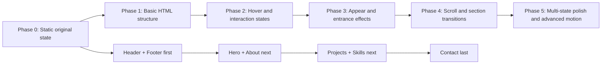

# Phase Roadmap

## Goal
Build the portfolio in this order:
1. Lock the original static state first.
2. Build the simplest structure next.
3. Add hover and interaction states after structure is stable.
4. Add appear / entrance effects after interaction states work.
5. Add section transition effects last.

## Phase Graph

## Phase 0: Static Original State
This is the current target for the next implementation pass.

### Order
- Header
- Footer
- Hero
- About
- Projects
- Skills
- Contact

### What to keep
- Only the original visible state for each component
- No loading gate
- No scroll-driven morphing
- No entrance transitions
- No hover motion unless it is required for basic usability

### Goal
Make the page inspectable, scrollable, and stable before adding visual complexity.

## Phase 1: Basic HTML Structure
Build the page structure first.

### What to define
- Section containers
- Component wrappers
- Layout slots for left/right or center content
- IDs for scrolling and future transitions

### Required order
- Header
- Footer
- Hero
- About
- Projects
- Skills
- Contact

## Phase 2: Hover and Interaction States
After structure is stable, add interaction states.

### Focus
- Custom cursor states
- Hover feedback
- Click feedback
- Drag feedback
- Card, box, and link reactions

### Goal
Make each section feel alive without changing its base layout.

## Phase 3: Appear Effects
Once hover states work, add entry animations.

### Focus
- Title entrance
- Avatar reveal
- Header and footer entrance
- Section element reveals

### Goal
Each section should appear with a controlled staged reveal.

## Phase 4: Transition Effects
Add the big scroll-driven transformations last.

### Focus
- Hero to About morph
- About to Projects expansion
- Projects to Skills shift
- Skills to Contact drain
- Contact to Footer override

### Goal
Make section changes feel cinematic without breaking the layout.

## Phase 5: Multi-State Polish
Once the transitions work, add the advanced states.

### Focus
- Original state
- Hover state
- Active state
- Transition state
- Recovery state

### Goal
Support the html-in-canvas, three.js, anime.js, theater.js, and custom CSS shape work in a controlled way.

## Implementation Rule
Do not start transition effects until:
- the static structure is finished
- the required assets are ready
- hover interactions work reliably
- appear animations are stable
