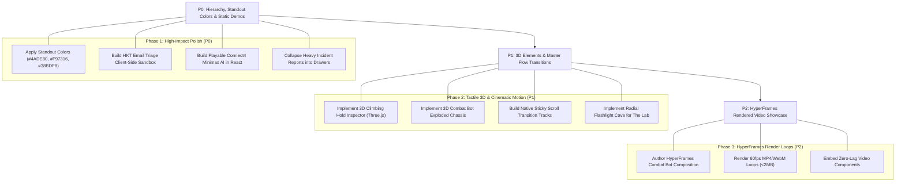

# 26-9 Master Engineering Roadmap // Portfolio Evolution

> **Date:** 2026-09-26  
> **Project:** Toto Lai's Interactive Portfolio (`new-personal-profolio`)  
> **Repository:** [`https://github.com/tototofu123/new-personal-profolio`](https://github.com/tototofu123/new-personal-profolio)  
> **Current Commit:** `dbec4fc`  

---

## Executive Summary

Today, we analyzed Toto Lai's complete project ecosystem across GitHub repositories (`all-about-me`, `tototofu123`, `perihel-transcribe`, `climbing-ai`, `inclusive-tourism-decision-platform`, `failed-projects-record`), local workspaces (`hkust-climbing-society`), and corporate experience at **HKT**. 

We identified Toto's true engineering identity: **A Kinetic Systems Builder and National Team Athlete who operates in high-consequence physical environments and builds software to solve immediate operational friction.**

We completely overhauled `new-personal-profolio` into a **zero-lag, high-performance telemetry portfolio**, eliminating lag-inducing unthrottled WebGL loops and replacing them with GPU-accelerated CSS layers, verified in headless browser testing and pushed to GitHub.

---

## User Feedback & Strategic Diagnosis

Following the initial deployment, the user provided critical design guidance:
1. **"Too much info to swallow"**: Dense text blocks feel academic. Needs bold scannability, giant hero metrics, and progressive disclosure drawers.
2. **"Key things don't have standout color to distinguish"**: Needs a strict, high-contrast signature color system so 1st-place wins, national athlete records, and multi-agent workflows pop immediately.
3. **"Where is the section-into-section animation transition also"**: The portfolio needs to revive the cinematic Master Flow transitions (Thermal Bleed, VR Perspective Zoom, Topo Elevation, Flashlight Cave, System Override Snap).
4. **"If you want interaction with my codebase, you can just make static code clones from my repos without pointing to any endpoint"**: Create self-contained client-side interactive sandboxes (HKT triage simulator, bouldering route builder, playable Connect4 AI) that run purely in the browser.
5. **"Still don't see much 3D elements or HTML in canvas"**: Bring back focused, optimized 3D elements (3D climbing hold inspector, 3D combat bot exploded chassis) with HTML-in-Canvas overlays and `IntersectionObserver` auto-freezing.
6. **"Or maybe use HyperFrames for demo"**: Pre-render silky 60fps motion graphic walkthroughs via HyperFrames to get cinematic visual fidelity with zero live GPU lag.

---

## Master Index of Todo Specifications

Each area has been thoroughly planned and documented in its own dedicated specification file:

| File | Focus Area | Core Deliverables | Priority |
|---|---|---|---|
| **[`01-PORTFOLIO_INFORMATION_HIERARCHY_AND_COLOR_SYSTEM.md`](./01-PORTFOLIO_INFORMATION_HIERARCHY_AND_COLOR_SYSTEM.md)** | **Anti-Overwhelm & Standout Colors** | • 5-Second Scan Rule • 4 Signature Standout Colors (`#4ADE80`, `#F97316`, `#38BDF8`, `#A855F7`) • Giant typography metrics • Progressive disclosure drawers | **P0 (Immediate)** |
| **[`02-THREEJS_3D_ELEMENTS_AND_HTML_IN_CANVAS.md`](./02-THREEJS_3D_ELEMENTS_AND_HTML_IN_CANVAS.md)** | **3D Elements & Canvas Overlays** | • 3D Bouldering Hold Mesh Inspector • 3D Combat Bot Exploded Chassis Viewer • HTML-in-Canvas DOM Projection Layer • `IntersectionObserver` auto-freeze hook | **P1 (High)** |
| **[`03-SCROLL_BASED_ANIMATIONS_AND_CINEMATIC_TRANSITIONS.md`](./03-SCROLL_BASED_ANIMATIONS_AND_CINEMATIC_TRANSITIONS.md)** | **Scroll Transitions & Master Flow** | • Thermal Bleed Morph (Hero $\rightarrow$ AI) • VR Portal Zoom (AI $\rightarrow$ Robotics) • Topo Elevation Altimeter (Robotics $\rightarrow$ Climbing) • Flashlight Cave Chamber (Climbing $\rightarrow$ Lab) • System Override Snap (Lab $\rightarrow$ Footer) | **P1 (High)** |
| **[`04-STATIC_REPO_CODE_CLONES_AND_INTERACTIVE_DEMOS.md`](./04-STATIC_REPO_CODE_CLONES_AND_INTERACTIVE_DEMOS.md)** | **Client-Side Interactive Sandboxes** | • HKT Email Triage Playground (Mock JSON & Teams Card) • Interactive Climbing Route Builder (Hold beta scorer) • Playable Connect4 Minimax AI in TypeScript • Perihel Dictation Terminal Simulator | **P0 (Immediate)** |
| **[`05-HYPERFRAMES_AND_MOTION_GRAPHICS_SHOWCASE.md`](./05-HYPERFRAMES_AND_MOTION_GRAPHICS_SHOWCASE.md)** | **HyperFrames Motion Video Showcase** | • `CombatBotArenaShowcase` (3D chassis & arena loop) • `ClimbingAppMobileWalkthrough` (Phone mockup loop) • `HktWorkflowTelemetryMesh` (Data particle loop) • Zero-lag `<video>` embed architecture | **P2 (Enhancement)** |

---

## Priority & Execution Roadmap

---

## Technical Guardrails (Zero-Lag Invariant)
1. **Never Intercept Native Wheel Events**: All scroll animations must use native sticky containers (`position: sticky; top: 0; height: 100vh`) with Framer Motion `useScroll`.
2. **Freeze All Offscreen Canvas Contexts**: Any Three.js canvas must auto-pause its render loop via `IntersectionObserver` when not visible.
3. **Clamp Device Pixel Ratio**: WebGL renderers must clamp to `Math.min(window.devicePixelRatio, 1.5)`.
4. **All Demos Purely Client-Side**: No live API keys, no external endpoints, zero latency.
